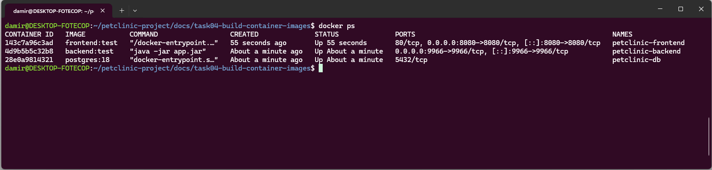
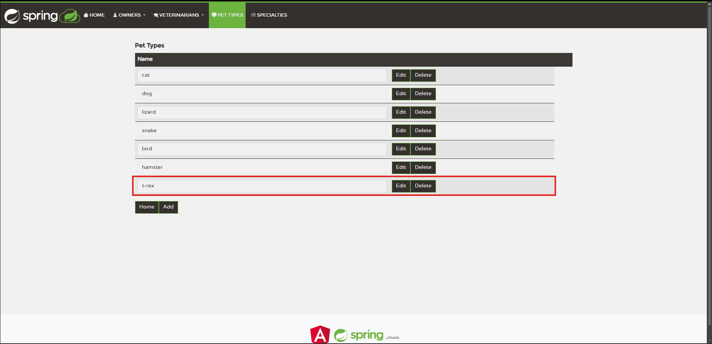
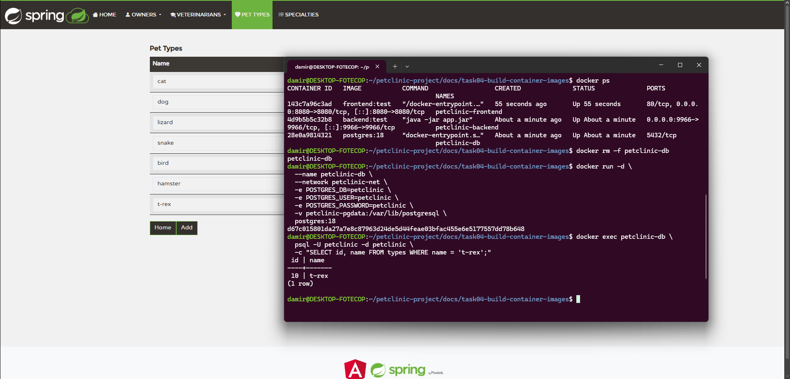

# Task 04 — Build Container Images

Containerized the Petclinic Angular frontend and Spring Boot backend using multi-stage Docker builds, alongside PostgreSQL with persistent storage.

**Containers running**



**Application working**



**PostgreSQL data persistence**




## Build Images

```bash
docker build -t frontend:test ./frontend
docker build -t backend:test ./backend
```

## Create Network and Volume

```bash
docker network create petclinic-net
docker volume create petclinic-pgdata
```

## Run PostgreSQL

```bash
docker run -d \
  --name petclinic-db \
  --network petclinic-net \
  -e POSTGRES_DB=petclinic \
  -e POSTGRES_USER=petclinic \
  -e POSTGRES_PASSWORD=petclinic \
  -v petclinic-pgdata:/var/lib/postgresql \
  postgres:18
```

## Run Backend

```bash
docker run -d \
  --name petclinic-backend \
  --network petclinic-net \
  -p 9966:9966 \
  -e SPRING_PROFILES_ACTIVE=postgres,spring-data-jpa \
  -e POSTGRES_URL=jdbc:postgresql://petclinic-db:5432/petclinic \
  -e POSTGRES_USER=petclinic \
  -e POSTGRES_PASS=petclinic \
  backend:test
```

## Run Frontend

```bash
docker run -d \
  --name petclinic-frontend \
  --network petclinic-net \
  -p 8080:8080 \
  frontend:test
```

Access the application at **http://localhost:8080**. The frontend currently expects the backend at `http://localhost:9966`.

